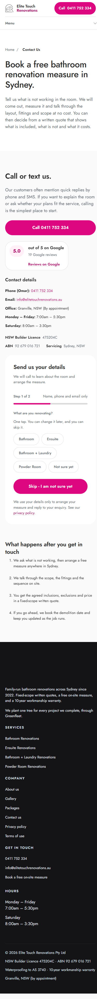
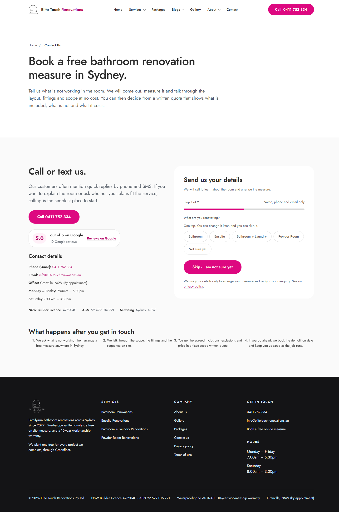

## Contact Us follow-up — 2026-11-08

The final review found the desktop form card stretched to match the taller information column. The rendered Contact Us page uses its own two-column layout, not the shared `ContactSection`.

**Adjustment:** the form card now follows its content height. The existing four-step process is below the call/form row; contact details remain beside the call action. No shared component, form submission code, or analytics behavior changed. Issue #78 remains closed.

**Verification:** production build generated 122 routes; typecheck, design scan and readability (116/116) passed. Playwright returned 200 at both 390×844 and 1440×900, with no page errors or horizontal overflow. An independent screenshot-only review found no P0/P1/P2 issues.

The database search for the exact #76 QA marker and synthetic test email found no matching enquiry, so no deletion was needed. This follow-up is local-only: no push or deployment was made.

