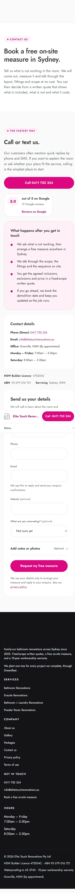
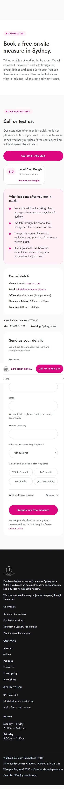
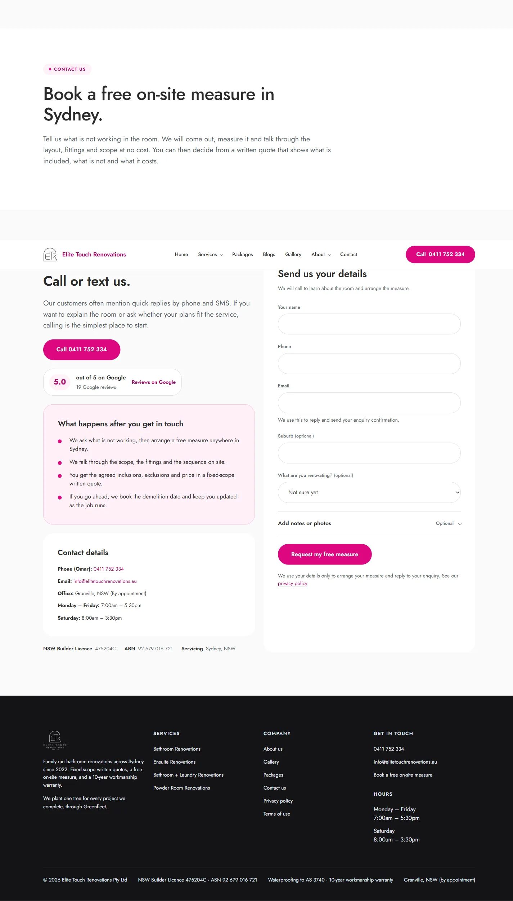
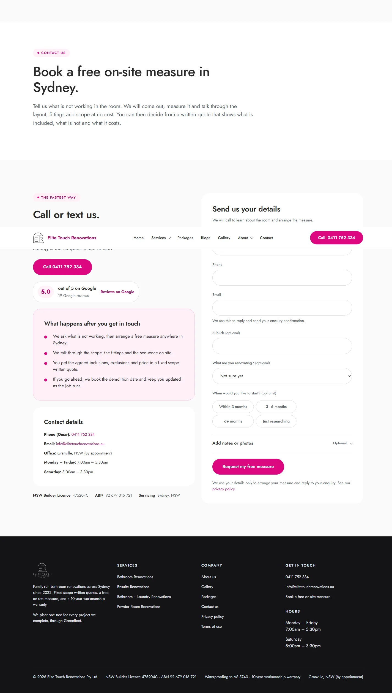

# Issue #70 — optional start-timing chips

Production-build evidence for the shared enquiry form. The before captures are from detached commit
`b651f0d`; the after captures are from `977ed74`, including the independent auditor's spacing fix.

| Viewport | Before | After |
|---|---|---|
| 390×844 |  |  |
| 1440×900 |  |  |

Independent final Vision Auditor verdict: **ACCEPT**. No P0 or P1 visual findings remain. The timing
group is visibly separate from the renovation select at both viewports, the four choices form a
legible 2×2 grid, and the primary enquiry button remains the dominant action.

Visible-browser verification also confirmed four optional native radios, fieldset/legend semantics,
visible keyboard focus, arrow-key selection, retained choice after validation errors, no horizontal
overflow, exact-once analytics, and safe success paths with and without a timing choice.
